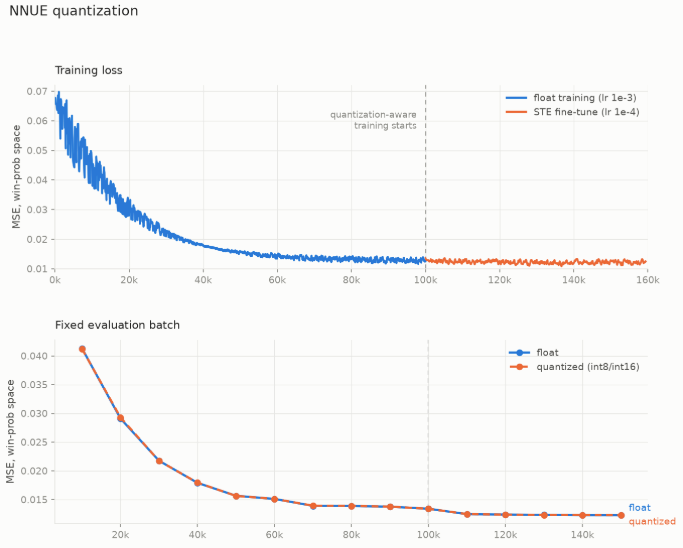

# Chess Engine

A UCI chess engine in C++, with an NNUE evaluation trained in PyTorch.


## Build and run

```bash
cmake -S . -B build-mac && cmake --build build-mac
./build-mac/chess_engine          # UCI
./build-mac/chess_engine -e       # eval tests (NNUE vs a fixture of known-good evals)
./build-mac/chess_engine -s       # mate finding
./build-mac/chess_engine -c       # perft
./build-mac/chess_engine -b       # search speed
```
 
## Development

### v0 — board and movegen

Bitboard representation, magic bitboards for sliding pieces, legal move generation
(no pseudo-legal filtering — pins and check evasions are handled during generation).
Perft-verified. Make/unmake restores state from a stack rather than copying the board.

### v1 — PeSTO evaluation

Tapered piece-square tables interpolating between middlegame and endgame by material.
Negamax with alpha-beta.

### v1.2 — draws

Zobrist hashing, incrementally updated in `make_move`. Repetition detection scans
backwards in steps of two, bounded by the halfmove clock since only positions after
the last irreversible move can repeat. Fifty-move rule.

### v1.3 — move ordering

MVV-LVA for captures (10×victim − attacker, so ordering is by what you win first),
PSQT delta for quiets. Selection sort rather than a full sort, since most nodes only
ever look at the first few moves.

### v1.4 — quiescence search

Captures-only search at the leaves to stop the engine evaluating positions mid-exchange.
Stand-pat with a beta cutoff, and SEE to skip losing captures. Evasions are generated in
full when in check, since captures alone can't answer one.

### v1.5 — transposition table

4.2M entry transposition table for caching evaluations. Used for cutoffs when the stored depth is
sufficient, and for move ordering when it isn't. 

### v2 — NNUE

HalfKP features (40960 = own-king square × piece × square), 256×2 → 32 → 32 → 1.

**Training** (`training/train.py`) streams positions from a binpack through
nnue-pytorch's C++ loader. Quantization-aware: weights are clipped to what int8 can
hold and rounded on the forward pass with a straight-through estimator, so the loss
being optimised is the quantised net's loss, not a float net's.



**Serialization** (`training/serialize.py`) folds the factorizer's virtual features
into the real ones, quantizes (FT → int16 at scale 127, l1 → int8 at 128, l2 and output
at 64), and writes a flat binary in the exact layout the engine reads feature-major
so one accumulator update is a contiguous 512-byte read. A 48-byte header carries the
dimensions and every scale, so a net built under a different scheme is rejected at load
rather than evaluated as nonsense.

**Inference** (`src/search/nnue.cpp`) keeps an int16 accumulator per perspective on the
search stack. Updates are lazy: `nnue_push` only records which pieces moved, and the
accumulator is materialised when a node actually evaluates. Most nodes never do  so the
eval is only reached in qsearch. King moves force a refresh of that side, since every
feature is indexed by own-king square.

Correctness is pinned by `src/test/nnue_examples.txt`: 500 FENs with the exact integer
output the engine must produce, generated by reading `nnue.bin` back and running the
pipeline on it. The C++ matches all 500 exactly.

### v2.1 — search and bug fixes

Late Move Reduction  

LMR reduces quiet moves late in the ordering by `0.75 + log(d)·log(m)/2.25`, re-searching
anything that beats alpha. 

Killers and history measured flat on their own, because move ordering was already
producing first-move cutoffs 79% of the time. They matter as a prerequisite for LMR
being safe to apply, not as a win in themselves.

### v2.2 — HalfKAv2_hm features

Swapped HalfKP for the feature set the nnue-pytorch loader already shipped with.

```
index = orient_flip_2(sq) + p_idx*64 + KingBuckets[o_ksq]*768
orient_flip_2: black flips vertically; the board flips horizontally
               when the perspective's own king is on files a-d
```

